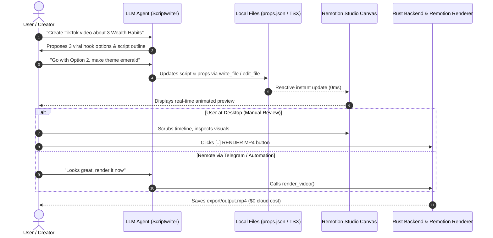

# ARUNAKINEXUS: Product Vision & System Roles Specification

**Version:** 1.0.0  
**Status:** Canonical Architecture Specification  
**Design Language:** Normal, rounded UI (Arunaki Agent parity)  

---

## 1. Product Vision & Core Purpose

### Problem Statement
Short-form content creators (TikTok, YouTube Shorts, Instagram Reels) are stuck between two undesirable extremes:
1. **Manual Editing (CapCut/Premiere):** Requires hours of repetitive manual alignment for a single 30-second vertical clip.
2. **Cloud AI Video SaaS (HeyGen, InVideo, Runway):**
   * Expensive recurring subscriptions.
   * Restrictive render quotas, queue timeouts, and cloud limits.
   * Privacy concerns: media assets and proprietary templates are hosted on third-party servers.

### The ArunakiNexus Solution
**ArunakiNexus** is an **Offline-First, Hardware-Accelerated Desktop Video Automation Workstation**:
* **Rp 0 Server Costs ($0 Forever):** All rendering utilizes the user's local GPU/CPU with Remotion + Chromium Headless + FFmpeg.
* **Hybrid Creative Workstation:** Pairs an interactive AI Scriptwriter with a zero-latency real-time Remotion Canvas Player.
* **Local Video Stock Vault:** Allows creators to store, categorize, and schedule dozens of finished videos directly on local disk.
* **Remote Control Capability (Telegram Bot / Mobile Trigger):** Enables creators to direct video ideas and trigger renders remotely while away from their workstation desk.

---

## 2. System Roles & Separation of Concerns

Each subsystem possesses a singular, distinct responsibility (*Single Responsibility Principle*):

```
+---------------------------------------------------------------------------------------+
|                                ARUNAKINEXUS WORKSTATION                               |
+---------------------------------------------------------------------------------------+
|                                                                                       |
|   [ USER / DIRECTOR ] <------------------- DIALOG & REVIEW ----------------------+    |
|            |                                                                     |    |
|            v (Direct Concept / Hook)                                             |    |
|   [ LLM / AI AGENT ]                                                             |    |
|   Role: Senior Scriptwriter & React Architect                                    |    |
|   - Discuss concepts, viral 3-second hooks, pacing, timeline structure           |    |
|   - Update props/TSX components via standard `write_file` / `edit_file` tools    |    |
|   - Push the render button via `trigger_render` (when invoked via bot/headless)  |    |
|            |                                                                     |    |
|            | 1. Update Props / Composition Files (.tsx / .json)                  |    |
|            v                                                                     |    |
|   [ REMOTION CANVAS PLAYER ] (Frontend Webview)                                  |    |
|   Role: Visual Presentation Engine                                               |    |
|   - Renders animations, typography, and video backgrounds in REAL-TIME (0ms)     |    |
|   - Provides interactive timeline scrubbing for the user                         |    |
|            |                                                                     |    |
|            | 2. Trigger MP4 Render (Manual UI Click OR Agent Remote Trigger)     |    |
|            v                                                                     |    |
|   [ RUST TAURI ENGINE & REMOTION RENDERER ] (Backend Sidecar)                    |    |
|   Role: Heavy Lifter & Native Host                                               |    |
|   - Executes Remotion bundler & Chromium Headless + FFmpeg                       |    |
|   - Outputs physical MP4 file: `export/output.mp4`                               |    |
|                                                                                       |
+---------------------------------------------------------------------------------------+
```

---

### Detailed Subsystem Responsibilities

#### A. User (Creative Director / Reviewer)
* Defines topic, target audience, angle, and core messaging.
* Audits visual composition in the live Canvas Player (timeline scrubbing, layout balance, typography legibility).
* Directs the LLM for revisions or approves final drafts.
* Manually clicks `[↓] RENDER MP4` on the desktop UI when satisfied.

#### B. LLM / AI Agent (Senior Scriptwriter & React Architect)
* **Brainstorming & Pacing:** Proposes viral hooks, 3-point body scripts, call-to-actions, and per-scene durations.
* **Code & Props Generator:** Translates agreed-upon creative directions into structured JSON props or edits Remotion components using standard workspace tools (`read_file`, `write_file`, `edit_file`).
* **Trigger Button (Not a Video Generator):** The LLM does **not** draw frames or compute video binaries internally. It merely triggers the render pipeline—acting like a digital finger pressing the render button—when asked to export (especially via Telegram bot or headless tasks).

#### C. Remotion (Visual Layout & Motion Engine)
* **Live Canvas Player:** Executes React components in the browser for instant, 60fps real-time preview without rendering an MP4.
* **Motion & Keyframes:** Calculates frame-level interpolations (`spring`, `interpolate`) deterministically.
* **Headless MP4 Exporter:** Drives `@remotion/renderer` to bake React components into binary MP4 files via local hardware acceleration.

#### D. Rust Backend & Tauri Core (Host & Process Orchestrator)
* Enforces isolated workspace security.
* Exposes the Tauri IPC bridge (`render_nexus_video`) connecting the UI button and agent calls to the Remotion Node.js sidecar.
* Manages local background tasks, OS telemetry, and video stock inventory.

#### E. Remote Channels (Telegram Bot Bridge)
* Provides remote access for the creator on mobile devices.
* Example interaction: User messages Telegram bot -> Agent drafts script, updates props, calls `render_video` -> Rust renders MP4 -> bot returns the video file to Telegram.

---

## 3. Render Tool Design: "Trigger Button" vs "Bloated Schema"

### The Anti-Pattern (Bloated Tool):
```json
// Overcomplicated: forces LLM to memorize 20+ visual styling arguments
render_video({
  "hook_text": "...",
  "body_text": "...",
  "theme_color": "emerald",
  "category": "PRODUCTIVITY",
  "font_size": 48,
  "background_video": "..."
})
```
*Why this fails:* The LLM should not duplicate Remotion's React component props inside an agent tool schema.

### The Best-Practice Pattern (Trigger Button):
```json
// Clean, minimal, acts exactly like pressing the UI button
render_video({
  "composition_id": "NexusShorts",       // optional (defaults to active canvas composition)
  "output_path": "export/wealth-habits.mp4" // optional (defaults to timestamped name)
})
```
*Benefits:*
1. **Separation of Concerns:** Script and styling stay where they belong (in `props.json` or `composition.tsx`), inspectable on the Canvas Player.
2. **Deterministic UI Parity:** Calling the tool produces the exact same result as clicking `[↓] RENDER MP4`.
3. **Versatile Dispatch:** Works identically whether triggered from the desktop UI, the chat agent, or an external Telegram webhook.

---

## 4. Standard Workflow Lifecycle



