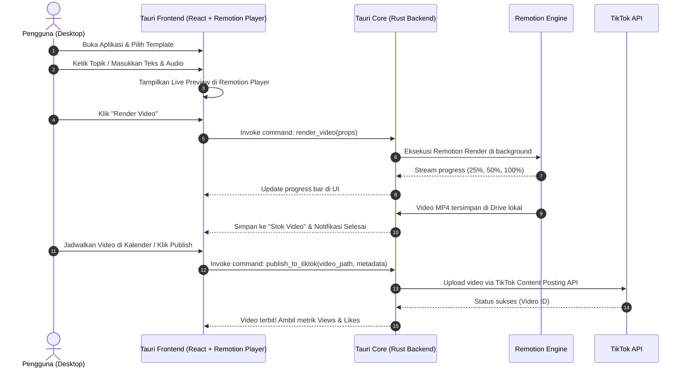

# PRD: ArunakiNexus Desktop (Tauri + Rust + Remotion)

**Format Aplikasi:** Windows Desktop Application (`.exe` / `.msi` Installer)  
**Arsitektur:** Offline-First & Hybrid (Tauri v2 + Rust Backend + React & Remotion Frontend)  
**Platform Prioritas Utama (P0):** **TikTok (Content Posting & Analytics)**  
*(Platform Sekunder: YouTube Shorts & Instagram Reels)*  
**Estimasi Biaya Server:** **Rp 0 (100% Gratis Selamanya)**

---

## 1. Visi & Konsep Produk

**ArunakiNexus Desktop** adalah aplikasi desktop native Windows yang dirancang khusus untuk kreator dan pengelola akun **TikTok** dalam memproduksi, mengelola persediaan (*stok*), menjadwalkan upload, dan memonitor performa video secara otomatis.

### Keunggulan Utama:
* **TikTok-First Focus:** Dirancang khusus untuk ekosistem TikTok (rasio 9:16 vertikal, tren sound/hook, analitik views & likes).
* **Sistem Manajemen Stok Video (Video Vault):** Buat batch video sekaligus dan timbun di komputer lokal sebagai cadangan konten harian.
* **Bebas Biaya Hosting (Rp 0):** Seluruh proses render video menggunakan CPU/GPU komputer lokal tanpa tagihan cloud.
* **Bebas Timeout & Aman:** Tidak ada batasan durasi render; token akun tersimpan terenkripsi di Windows lokal.

---

## 2. Arsitektur Teknologi

```
+-------------------------------------------------------------------+
|                   ARUNAKINEXUS DESKTOP (.EXE)                     |
+-------------------------------------------------------------------+
|  FRONTEND (UI & Preview)                                          |
|  - Framework: React 19 + Vite + Tailwind CSS                      |
|  - Player: @remotion/player (Preview interaktif real-time)        |
|  - Forms: Dynamic Props Editor (Zod-driven)                       |
+-------------------------------------------------------------------+
|  IPC BRIDGE (Tauri v2 Inter-Process Communication)                |
+-------------------------------------------------------------------+
|  BACKEND CORE (Rust)                                              |
|  - Window & System Management (Tauri Native Core)                 |
|  - Database Lokal: SQLite (via rusqlite / sqlx)                   |
|  - File & Storage Manager: Local File System (Drive E:/Videos)    |
|  - Task Scheduler: Cron background thread lokal                   |
|  - Keamanan Token: Windows Credential Vault / AES-256             |
+-------------------------------------------------------------------+
|  LOCAL RENDER ENGINE (Remotion Sidecar)                           |
|  - Node.js Sidecar / CLI (@remotion/renderer + FFmpeg + Chromium) |
+-------------------------------------------------------------------+
```

---

## 3. Daftar Fitur Lengkap (Feature Specifications)

### Modul 1: Remotion Video Player & Template Studio
* **F-1.1 Live Video Player:**
  * Menggunakan `@remotion/player` di dalam tampilan aplikasi desktop.
  * Dilengkapi tombol Play, Pause, Timeline Scrubber bar, Fullscreen, dan pemilih frame per frame.
* **F-1.2 Dynamic Props Editor:**
  * Form input untuk mengubah teks judul, hook teks, warna background, posisi font, dan durasi video.
  * Perubahan pada form langsung ter-update di layar player secara instan tanpa loading.
* **F-1.3 Template Pilihan Vertikal (9:16):**
  * *Template Fakta / Edukasi:* Background video dinamis + teks typewriter + audio suara latar.
  * *Template Kutipan / Motivasi:* Animasi minimalis, background blur estetis, musik relaksasi.
  * *Template Promosi Produk:* Slideshow gambar produk + teks promo badge + hook penawaran.

---

### Modul 2: AI Scripting & Generator Konten
* **F-2.1 Auto-Generate Konten Berdasarkan Topik:**
  * Pengguna cukup mengetik topik (contoh: *"5 Kebiasaan Orang Sukses"*).
  * AI menghasilkan: Naskah 3 bagian (Hook, Isi, Call-to-Action), caption sosmed, serta rekomendasi hashtag.
* **F-2.2 Fleksibilitas Penyedia AI:**
  * **Opsi Cloud API:** Google Gemini API (gratis) atau OpenAI API (pengguna memasukkan API key sendiri di pengaturan).
  * **Opsi Full-Offline (Masa Depan):** Integrasi dengan model lokal seperti Ollama.

---

### Modul 3: Local Render Engine (Bebas Biaya & Tanpa Limit)
* **F-3.1 Render MP4 Berkualitas Tinggi:**
  * Merender video langsung di resolusi Full HD (1080x1920, 30/60 fps) format H.264 MP4.
  * Memanfaatkan akselerasi hardware (CPU multithread & GPU) komputer pengguna.
* **F-3.2 Progress Tracker Real-Time:**
  * Progress bar persentase (0% - 100%), estimasi sisa waktu (ETA), dan frame rate render.
* **F-3.3 Custom Output Directory:**
  * Pengguna bebas memilih folder penyimpanan hasil video (misal: `E:\Videos\ArunakiNexus`).
  * Tombol *"Open in File Explorer"* langsung membuka lokasi video setelah render selesai.

---

### Modul 4: Manajemen Stok Video (Video Inventory & Content Vault)
* **F-4.1 Pool Cadangan Konten (Video Stock Buffer):**
  * Halaman khusus *"Stok Video"* yang menampilkan seluruh video yang sudah selesai dirender dan siap dipublikasikan.
  * Indikator status stok: *"Tersedia 15 video (Cukup untuk 5 hari posting)"*.
  * Peringatan otomatis (*Low Stock Warning*) jika persediaan video kurang dari 3 hari.
* **F-4.2 Batch Content Queue & Generator:**
  * Pengguna bisa memasukkan 10 topik sekaligus ➔ Sistem me-render secara berurutan dan memasukkannya langsung ke dalam stok.
* **F-4.3 Tagging & Organisasi Konten:**
  * Pengelompokan video berdasarkan niche/kategori (misal: Tips, Quotes, Promosi Produk, Fakta Unik).
  * Filter video berdasarkan status: *Draft*, *Ready in Stock*, *Scheduled*, *Published*.
* **F-4.4 Penyimpanan SQLite Lokal:**
  * Metadata, caption, hashtag, dan path file MP4 tersimpan di database SQLite lokal (`arunakinexus.db`).

---

### Modul 5: TikTok Auto-Publisher & Kalender Penjadwalan
* **F-5.1 Integrasi TikTok Login Kit & Content Posting API:**
  * Otorisasi akun TikTok resmi via OAuth 2.0.
  * Refresh token otomatis; data token terenkripsi aman di Windows.
* **F-5.2 Kalender Penjadwalan Visual (Content Calendar):**
  * Tampilan kalender mingguan & bulanan.
  * Cukup drag-and-drop atau pilih video dari "Stok Video" ke slot jam tayang (misal: 12.00, 18.00, 21.00).
  * Opsi auto-schedule: Otomatis membagi stok video ke jadwal posting harian (contoh: 2 video per hari secara konsisten).
* **F-5.3 Publikasi Langsung (1-Click Publish ke TikTok):**
  * Opsi posting seketika atau posting sesuai jadwal.
  * Otomatis mengisi caption, hashtag FYP trending, mention akun, izin komentar/duet/stitch, dan pengaturan visibilitas (Public, Friends, Only Me).

---

### Modul 6: Monitoring Akun TikTok & Analitik Performa (Views & Likes)
* **F-6.1 Dashboard Metrik TikTok (Real-Time Stats):**
  * Menampilkan metrik utama per akun:
    * **Total Views** (Jumlah tayangan keseluruhan & tren harian).
    * **Total Likes** & rasio Like-to-View.
    * **Komentar & Shares**.
    * **Jumlah Followers** dan pertumbuhannya.
* **F-6.2 Tabel Performa Video (Video Performance Breakdown):**
  * Daftar seluruh video TikTok yang telah diterbitkan beserta metrik langsung:
    * Judul/Caption | Tanggal Post | Views | Likes | Comments | Share | Status FYP.
  * Fitur sorting: Urutkan video dari views terbanyak untuk melihat konten mana yang meledak (*viral*).
* **F-6.3 Monitoring Multi-Akun TikTok:**
  * Kelola beberapa akun TikTok dalam satu aplikasi (misal: Akun A, Akun B, Akun Klien).
  * Switch antar akun dengan 1-klik untuk melihat stok video dan performa masing-masing akun.
  * Status koneksi akun: 🟢 Aktif / 🔴 Perlu Re-Login.

---

### Modul 7: Distribusi & Installer Windows
* **F-7.1 Windows Installer Standar:**
  * Build otomatis menghasilkan file instalasi Windows: `.msi` dan setup `.exe`.
  * Desktop shortcut icon dan Start Menu integration.
* **F-7.2 Portable Mode (Opsional):**
  * Opsi menjalankan aplikasi dalam format standalone `.exe` tanpa perlu instalasi.

---

## 4. Alur Kerja Aplikasi (Workflow)



---

## 5. Rencana Tahapan Pengerjaan (Milestones)

1. **Fase 1: Inisialisasi Fondasi Tauri + React + Remotion**
   * Setup proyek Tauri v2 dengan Vite + React + Tailwind CSS.
   * Pasang `@remotion/player` dan buat template vertikal 9:16 pertama.
   * Uji coba preview player di jendela desktop native Windows.

2. **Fase 2: Mesin Render Lokal (Rust to Remotion)**
   * Buat perintah Tauri/Rust untuk mengeksekusi render MP4 ke folder lokal.
   * Hubungkan progress bar render antara backend Rust dan UI React.

3. **Fase 3: Local Storage & AI Generator**
   * Setup SQLite lokal untuk menyimpan draft proyek dan histori video.
   * Integrasi Gemini API untuk auto-generate teks naskah.

4. **Fase 4: Integrasi YouTube & Monitoring Akun**
   * Implementasi OAuth YouTube Data API v3 & penyimpanan token lokal.
   * Dashboard monitoring status akun, tracker kuota harian, dan metrik analitik (Views/Likes).

5. **Fase 5: Pengujian End-to-End & Packaging Installer**
   * Uji coba alur utuh: Ide -> Template -> Render MP4 -> Upload YouTube -> Monitor Metrik.
   * Konfigurasi bundling Tauri untuk menghasilkan file `ArunakiNexus-Setup.exe` dan `.msi`.

