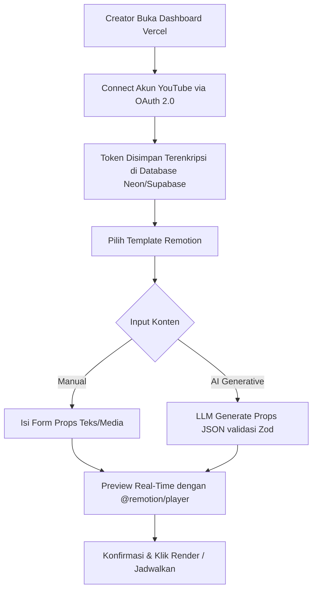
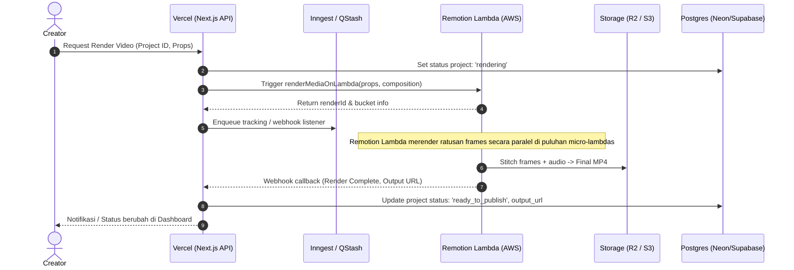

# PRD: Platform Otomasi Konten Sosmed dengan Remotion (Vercel-Optimized)

**Versi:** 1.1 (Vercel Architecture Edition)  
**Status:** Approved for Implementation  
**Target Platform:** Web (Vercel + Serverless Backend + Distributed Render Worker)

---

## 1. Ringkasan Eksekutif & Penyesuaian Arsitektur Vercel

**Autoreel** adalah platform SaaS otomasi pembuatan dan penerbitan video pendek vertikal (YouTube Shorts, TikTok, Instagram Reels) berbasis template **Remotion** dan integrasi API resmi platform sosial.

### Tantangan Arsitektur Vercel & Solusinya
Vercel adalah platform hosting terbaik untuk frontend Next.js dan Serverless/Edge API, namun memiliki batasan kritis untuk rendering video:
* **Batasan Vercel:** Batas waktu eksekusi (timeout 10–60 detik pada tier gratis/hobby, maks 300 detik pada Pro), ukuran bundle fungsi terbatas (tidak muat browser Chromium/FFmpeg lengkap), dan ketiadaan persistent process untuk background workers (seperti `BullMQ worker.run()`).
* **Solusi Vercel-Optimized:**
  1. **Frontend & Management API di Vercel:** Next.js (App Router), Tailwind CSS, NextAuth, Server Actions, dan `@remotion/player` (preview interaktif client-side langsung di browser tanpa render).
  2. **Antrean & Scheduler Serverless:** Menggunakan **Upstash QStash** atau **Inngest** (berbasis HTTP Webhook, 100% serverless, tanpa butuh persistent Redis worker daemon).
  3. **Mesin Render Video:** Menggunakan **Remotion Lambda (`@remotion/lambda` di AWS)** atau **Dedicated Container Worker (Railway / Fly.io / Modal)**. Remotion Lambda memecah frame video dan merender secara paralel di ratusan fungsi AWS Lambda (video 30 detik selesai dalam 10-15 detik) lalu mengunggah langsung ke AWS S3 / Cloudflare R2.

---

## 2. Tech Stack Rekomendasi (Vercel Ecosystem)

| Layer | Komponen / Library | Peran & Justifikasi |
|---|---|---|
| **Web & App Layer** | **Next.js 15 (App Router) di Vercel** | Dashboard, formulir dinamis Zod, server actions, dan optimasi aset otomatis. |
| **Video Player (Preview)** | **`@remotion/player`** | Menjalankan komposisi React langsung di canvas browser pengguna tanpa membebani server/kuota render. |
| **Database** | **Neon / Supabase PostgreSQL** + **Prisma / Drizzle** | Serverless PostgreSQL dengan native connection pooling yang aman terhadap concurrency Vercel. |
| **Authentication** | **Auth.js (NextAuth v5)** | Autentikasi sesi via JWT/Database adapter, terintegrasi mulus dengan Vercel Edge/Node runtime. |
| **Queue & Scheduling** | **Inngest** atau **Upstash QStash** | Queue & Cron scheduler berbasis HTTP webhook yang dirancang khusus untuk arsitektur serverless Vercel. |
| **Video Rendering Engine** | **`@remotion/lambda` (AWS Lambda)** *(Rekomendasi Utama)*<br>_Alternatif:_ **Docker Worker (Railway/Fly.io)** | Merender ribuan frame secara terdistribusi dalam hitungan detik. Bebas dari timeout Vercel. |
| **Object Storage** | **Cloudflare R2** atau **AWS S3** | Menyimpan aset (gambar, audio, font) dan video final dengan zero-egress cost (R2) dan signed URLs. |
| **AI Layer** | **Google Gemini 2.5 Flash / OpenAI API** | Menghasilkan skrip, hook, caption, hashtag, dan props JSON terstruktur berbasis Zod. |
| **Social API Publisher** | **YouTube Data API v3** (MVP), **TikTok Content Posting API**, **Meta Graph API** | Penerbitan resmi dengan OAuth 2.0 & token encryption (AES-256-GCM). |

---

## 3. Alur Kerja (Workflow) Sistem Terintegrasi

### Workflow 1: Creator Onboarding & Pembuatan Video


---

### Workflow 2: Pipeline Render Video Serverless (Vercel ke Remotion Lambda)


---

### Workflow 3: Pipeline Penjadwalan & Penerbitan Otomatis (Publishing)
```mermaid
flowchart TD
    Cron[Inngest Cron / QStash Schedule] -->|Cek Jadwal Posting| Trigger[Vercel Serverless Function /api/cron/publish]
    Trigger --> QueryDB[Ambil job dengan scheduled_at <= NOW() dan status = 'approved']
    QueryDB --> CheckQuota{Cek Kuota Harian API Platform?}
    CheckQuota -->|Kuota Penuh| DelayJob[Tunda Job ke Jendela Kuota Besok]
    CheckQuota -->|Kuota Aman| RefreshToken[Refresh Access Token OAuth jika Expired]
    RefreshToken --> Upload[Upload Video MP4 dari Storage ke YouTube/TikTok API]
    Upload --> VerifyUpload{Upload Berhasil?}
    VerifyUpload -->|Gagal Sementara| Retry[Retry dengan Exponential Backoff]
    VerifyUpload -->|Gagal Permanen| ErrorAlert[Kirim Notifikasi Error ke User]
    VerifyUpload -->|Sukses| Success[Update Status: 'published', simpan external_post_id]
```

---

## 4. Kebutuhan Fungsional (Functional Requirements)

### 4.1 Manajemen Akun & Multi-Tenant (Vercel-Friendly)
* **FR-01:** Autentikasi aman berbasis Auth.js dengan dukungan Email Magic Link / Credentials dan database session.
* **FR-02:** Arsitektur workspace multi-tenant: setiap query data diisolasi menggunakan filter `workspace_id`.
* **FR-03:** OAuth 2.0 social accounts manager dengan automated token refresh logic sebelum request publikasi dijalankan.

### 4.2 Template Remotion & Dynamic Props
* **FR-10:** Komposisi Remotion didefinisikan dengan skema `zod`.
* **FR-11:** Form dinamis di Next.js di-generate otomatis dari schema Zod tersebut.
* **FR-12:** Komponen `@remotion/player` dirender secara interaktif di sisi klien (Next.js client component) untuk pratinjau instan tanpa biaya server.
* **FR-13:** Upload aset langsung dari browser ke S3/R2 menggunakan Presigned Upload URLs (tanpa membebani bandwidth Vercel).

### 4.3 Rendering & Background Jobs
* **FR-20:** Pemicuan render dilakukan melalui SDK `@remotion/lambda`.
* **FR-21:** Vercel menerima status progress render secara streaming atau melalui periodic polling / webhook callback.
* **FR-22:** Penanganan failure: maksimal 3 kali retry dengan idempotency key.

### 4.4 Penjadwalan & Multi-Platform Publishing
* **FR-30:** Penjadwalan video berbasis zona waktu pengguna (*timezone-aware*).
* **FR-31:** Handler publikasi YouTube Data API v3 (`videos.insert`) dengan penanganan kuota otomatis (1600 unit per upload).
* **FR-32:** Persiapan arsitektur adapter untuk TikTok Content Posting API & Instagram Graph API pada fase rilis berikutnya.

---

## 5. Rencana Tahapan Rilis (Milestone & Roadmap)

1. **Sprint 1 (Fondasi & Preview Remotion):**
   * Setup Next.js 15, Tailwind, Prisma/Drizzle di Vercel.
   * Buat template Remotion pertama (Shorts 9:16) dan pasang `@remotion/player` di dashboard.
   * Hubungkan form input props ke Remotion Player.

2. **Sprint 2 (Serverless Rendering Pipeline):**
   * Setup AWS Lambda & S3 dengan CLI `@remotion/lambda`.
   * Buat endpoint `/api/render` di Next.js untuk memicu render ke Lambda.
   * Pasang webhook listener untuk mengupdate status render di database.

3. **Sprint 3 (OAuth & YouTube Auto-Publish):**
   * Integrasi Google OAuth 2.0 dengan scope YouTube Upload.
   * Setup Inngest / Upstash QStash untuk penjadwal publish otomatis.
   * Pengujian end-to-end: Form -> Preview -> Render Lambda -> Publish YouTube.

4. **Sprint 4 (AI Scripting & Polishing):**
   * Integrasi Gemini API untuk auto-generate skrip, hook, dan hashtag.
   * Error tracking dengan Sentry & peluncuran MVP.

